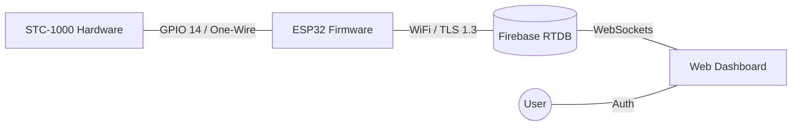
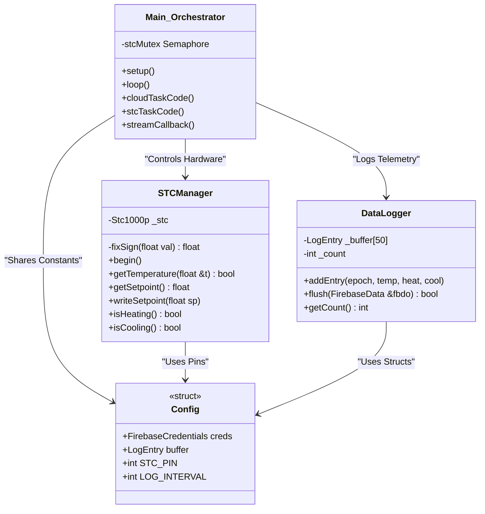
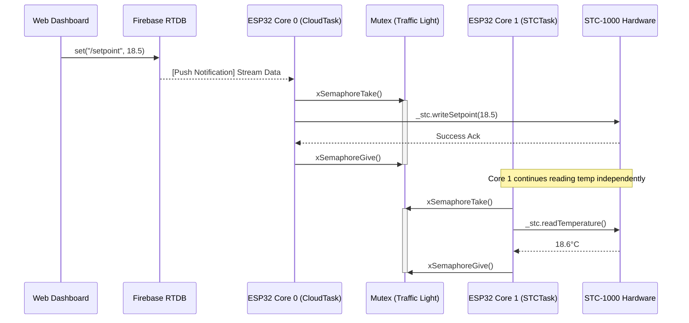
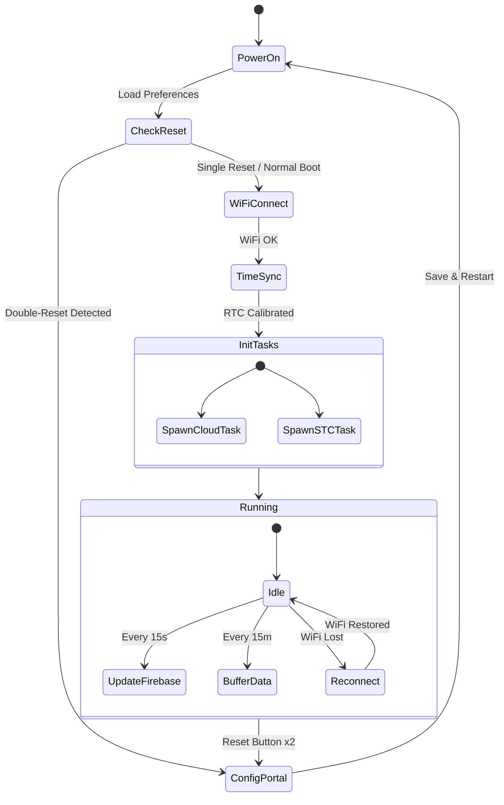

# STC-1000 ESP32 Architecture

This document outlines the professional firmware architecture and system flow for the STC-1000 ESP32 IoT controller.

## 1. System Topology
The system uses a Star Topology with Firebase as the central synchronization hub.

## 2. Firmware Class Diagram
The firmware is built using a modular, encapsulated approach to separate hardware concerns from cloud logic.

## 3. Real-Time Command Sequence
This illustrates how a setpoint change on your phone reaches the hardware in milliseconds via the Firebase Stream.

## 4. Device State Machine
The lifecycle of the device from power-on to steady-state operation.

